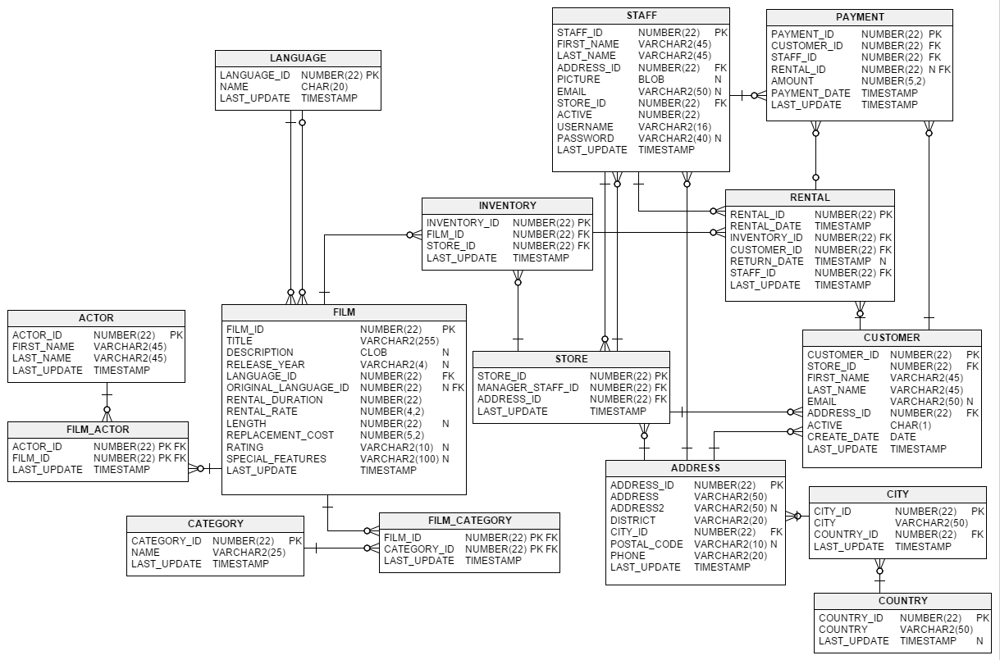

# Sakila Database Query Assistant

## Overview

The Sakila Database Query Assistant is an intelligent web application that allows users to query the MySQL Sakila
sample database using natural language. Built with Streamlit, it leverages the power of Llama3.2 LLM via Ollama to
automatically convert natural language questions into SQL queries, execute them, and present the results in an
intuitive interface.

This application bridges the gap between business users who need data insights and the technical complexity of
writing SQL queries, making database analysis accessible to non-technical stakeholders.

## Key Features

- **Natural Language Processing**: Convert plain English questions into executable SQL queries using
        Llama3.2 LLM
- **Interactive Web Interface**: User-friendly Streamlit-based interface with real-time query
        processing
- **Database Schema Visualization**: Built-in schema browser and visual representation
- **KPI Definitions**: Predefined Key Performance Indicators for business metrics
- **Query History**: Track and reuse previous queries for efficiency
- **Result Export**: Download query results as CSV files
- **Error Handling**: Comprehensive error reporting and debugging information
- **Example Queries**: Pre-built example queries to get users started
- **Read-Only SQL Allowlist**: Generated SQL is parsed before execution; only a
        single `SELECT`/`WITH`/`UNION` statement is accepted, with a forced row cap

## Architecture

The application follows a modular architecture with clear separation of concerns:

- **Frontend Layer**: Streamlit web application (`app.py`)
- **Business Logic Layer**: Utility functions for data processing (`utils.py`)
- **Data Layer**: MySQL Sakila database connection
- **AI Layer**: Llama3.2 model via Ollama for natural language processing
- **Configuration Layer**: KPI definitions and database schema metadata

## Prerequisites

Before running the application, ensure you have the following components installed and configured:

### System Requirements

- Python 3.11 or higher
- Docker (for Sakila database container)
- Ollama (for Llama3.2 model)
- Minimum 8GB RAM recommended
- Internet connection for initial model download

### Required Software

- **Docker**: Container platform for running MySQL Sakila database
- **Ollama**: Local LLM runtime for Llama3.2 model
- **Python Dependencies**: Listed in requirements.txt

## Installation and Setup

### Step 1: Clone the Repository

    git clone https://github.com/Gasta88/sakila_bot
    cd sakila_bot

### Step 2: Install Python Dependencies

    pip install -r requirements.txt

Dependencies are pinned in `requirements.txt`:

- `streamlit` - Web application framework
- `mysql-connector-python` - MySQL database connector
- `pandas` - Data manipulation and analysis
- `sqlglot` - SQL parser used by the read-only allowlist

For development and tests, also install `requirements-dev.txt` (pytest + ruff).

### Step 3: Set Up Docker and Sakila Database

    # Pull and run the Sakila MySQL container
    docker run -d -p 3306:3306 --name sakila sakiladb/mysql
    
    # Verify the container is running
    docker ps | grep sakila

### Step 4: Install and Configure Ollama

    # Install Ollama (Linux/macOS)
    curl -fsSL https://ollama.com/install.sh | sh
    
    # Pull the Llama3.2 model
    ollama pull llama3.2
    
    # Verify model installation
    ollama list

### Step 5: Run the Application

Use the provided shell script for automated startup:

    chmod +x run.sh
    ./run.sh

Or run manually:

    streamlit run app.py

## Configuration

### Database Connection

The application connects to MySQL using the following default configuration:

- **Host**: localhost
- **Port**: 3306
- **Database**: sakila
- **Username**: sakila
- **Password**: p\_ssW0rd

Every value can be overridden with an environment variable, which avoids editing
code for a different container:

| Variable | Default | Purpose |
| --- | --- | --- |
| `SAKILA_DB_HOST` | `localhost` | MySQL host |
| `SAKILA_DB_PORT` | `3306` | MySQL port |
| `SAKILA_DB_USER` | `sakila` | MySQL user |
| `SAKILA_DB_PASSWORD` | `p_ssW0rd` | MySQL password |
| `SAKILA_DB_NAME` | `sakila` | Database name |
| `SAKILA_MAX_ROWS` | `1000` | Hard cap applied to every generated query |
| `OLLAMA_TIMEOUT` | `120` | Seconds to wait for the local model |

**Note**: These credentials are for the sample Sakila database container. In production environments,
      ensure proper security measures and credential management.

### KPI Definitions

The application includes predefined KPIs organized into categories:

#### Revenue Metrics

- **Total Revenue**: Sum of all customer payments
- **Average Transaction Value (ATV)**: Average amount per rental transaction
- **Revenue by Film Category**: Revenue breakdown by genre

#### Customer Metrics

- **Customer Lifetime Value (CLV)**: Total revenue per customer relationship
- **Customer Retention Rate**: Percentage of repeat customers
- **Average Rentals per Customer**: Mean rental frequency per customer

#### Inventory Metrics

- **Film Utilization Rate**: Frequency of film rentals
- **Revenue per Film**: Total revenue generated per film title
- **Most Popular Films**: Films with highest rental counts

#### Staff Performance

- **Revenue per Staff**: Revenue processed by each staff member
- **Rentals Processed per Staff**: Transaction volume per staff member

## Usage Guide

### Basic Query Process

1. **Access the Application**: Navigate to the Streamlit interface (typically http://localhost:8501)
2. **Review Database Schema**: Check the sidebar for table structure and relationships
3. **Enter Natural Language Query**: Type your question in plain English
4. **Execute Query**: Click "Run Query" to process your request
5. **Review Results**: Examine the generated SQL and query results
6. **Export Data**: Download results as CSV if needed

### Example Queries

The application provides built-in example queries to demonstrate capabilities:

- "What are the top 10 most rented films?"
- "Calculate the average revenue per customer"
- "Show me customer retention rate by city"
- "Which actor appeared in the most films?"

### Advanced Features

#### Query History

The application maintains a session-based history of executed queries, allowing users to:

- View previously executed queries with timestamps
- Reuse successful queries with one click
- Build upon previous analysis

#### Debug Information

Each query execution provides detailed debugging information including:

- Generated SQL query with syntax highlighting
- Full LLM response for troubleshooting
- Error messages with context

## File Structure

| File | Purpose | Description |
| --- | --- | --- |
| `app.py` | Main Application | Streamlit web interface, database connectivity, user interaction handling |
| `utils.py` | Utility Functions | LLM integration, SQL validation and execution, database schema extraction |
| `kpi_definitions.md` | Business Metrics | Predefined KPI definitions for business intelligence |
| `requirements.txt` | Dependencies | Pinned Python package requirements for the application |
| `requirements-dev.txt` | Dev Dependencies | Pinned lint and test tooling |
| `run.sh` | Startup Script | Automated setup and launch script for Docker and Ollama |
| `test/unit/` | Tests | Mocked unit tests for utilities and the SQL allowlist |
| `docs/schema.png` | Diagram | Sakila entity-relationship diagram shown in the UI |
| `.github/workflows/ci.yml` | CI | Ruff lint and pytest on every push and pull request |
| `LICENSE` | License | MIT |

## Technical Implementation Details

### Natural Language Processing

The application uses Llama3.2 model via Ollama with a carefully crafted prompt that includes:

- Database schema context for accurate table and column references
- KPI definitions for business metric calculations
- SQL best practices including table aliases and type casting
- Error prevention guidelines

### SQL Generation Process

1. **Context Preparation**: Combine user query with database schema and KPI definitions
2. **LLM Processing**: Send structured prompt to Llama3.2 model
3. **Response Parsing**: Extract SQL code from markdown-formatted response
4. **Query Validation**: `utils.validate_sql` parses the statement with sqlglot and only
   accepts a single read-only `SELECT`/`WITH`/`UNION` query. DDL, DML, locking clauses,
   file/sleep functions and multi-statement input are rejected, and a `LIMIT` cap
   (`SAKILA_MAX_ROWS`, default 1000) is enforced.
5. **Execution**: Run the validated query against MySQL over a best-effort read-only session

### Error Handling

The application implements comprehensive error handling for:

- Database connection failures
- SQL syntax errors
- LLM communication issues
- Invalid query results
- File system access problems

## Troubleshooting

### Common Issues and Solutions

#### Database Connection Problems

**Issue**: "Error connecting to database"

**Solution**:

- Verify Docker container is running: `docker ps | grep sakila`
- Restart container: `docker start sakila`
- Check port availability: `netstat -an | grep 3306`

#### Ollama Model Issues

**Issue**: "Error calling Llama3.2 via Ollama"

**Solution**:

- Verify Ollama is running: `ollama list`
- Pull model if missing: `ollama pull llama3.2`
- Restart Ollama service

#### SQL Generation Problems

**Issue**: "Could not generate SQL from your query"

**Solution**:

- Rephrase query with more specific language
- Use table/column names from the schema
- Reference provided example queries

### Performance Optimization

- **Model Performance**: Ensure sufficient RAM allocation for Llama3.2
- **Database Queries**: Monitor complex queries for performance impact
- **Session Management**: Clear query history periodically for optimal performance

## Testing and CI

The unit tests mock MySQL and Ollama, so no services are required:

    pip install -r requirements-dev.txt
    ruff check .
    pytest -q

`test/unit/test_utils.py` covers schema extraction, LLM response parsing, the
normalised `(sql, response)` contract, and the SQL allowlist — including a test
that proves `DROP TABLE` is rejected. CI runs the same two commands on Python 3.11
for every push to `main` and every pull request.

The tests do not require Docker or Ollama; running the Streamlit UI does.

## License

Released under the [MIT License](LICENSE).

## Security Considerations

This application is a demonstration project. The following controls are implemented:

- **Read-only SQL allowlist**: generated SQL is parsed with sqlglot before execution;
  only one `SELECT`/`WITH`/`UNION` statement is accepted, DDL/DML and multi-statement
  input are rejected, and a row cap is always applied (`utils.validate_sql`).
- **Read-only session**: the MySQL session is switched to read-only on connect as a
  second line of defence (`utils.enforce_read_only_session`).
- **Configurable credentials**: connection settings can be supplied via environment
  variables instead of editing source.

Still out of scope for this demo: authentication/authorization, network restrictions,
and connection encryption. Use a dedicated read-only database user if you deploy it
beyond the local Sakila container.
